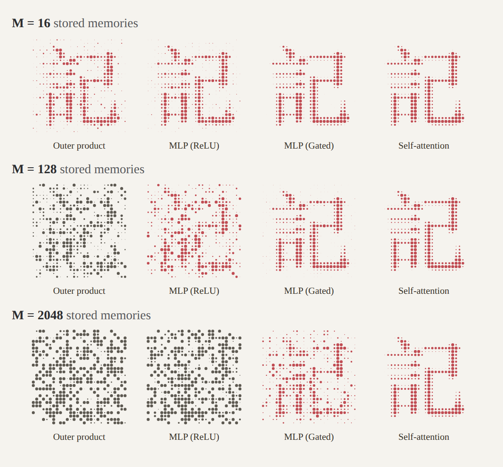
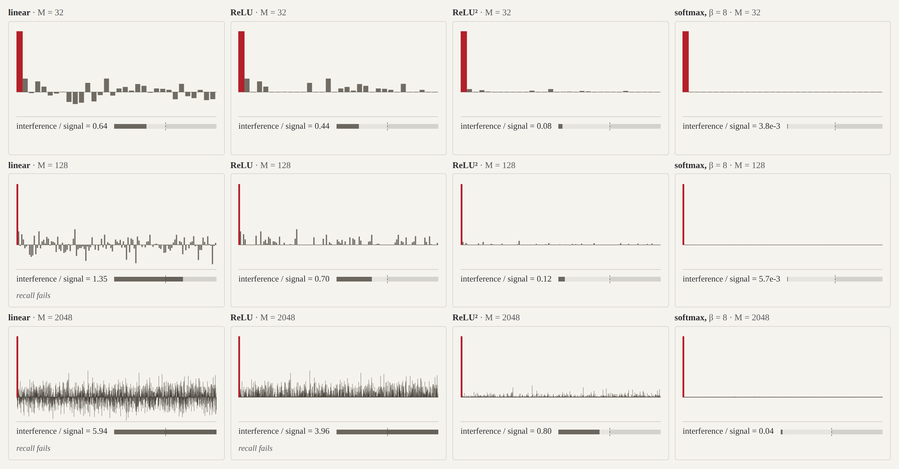
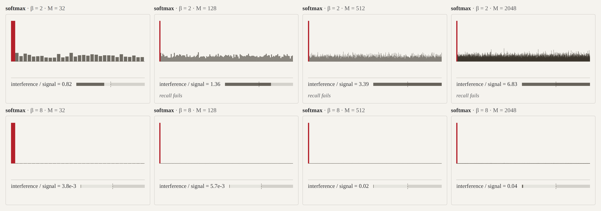

# You could have invented transformers from memory

*Every layer is a memory store*

Alex Wang · 2026-10-15 · 原文：<https://alexwang.ai/posts/associative-memory/>

[code](https://github.com/KeAWang/associative-memory-blog) · [interactive app](https://alexwang.ai/posts/associative-memory/#interactive) · [交互图合集（本地 HTML）](interactive-figures.html)

*Retrieving a character from memory. The recall worsens as the number of memories grows. 上图为 M = 16 / 128 / 2048 三个时刻的静态截图（原图会从 16 动态增长到 2048）；[在浏览器中打开可交互版本](interactive-figures.html#recall)。*

Large language models today can recall obscure facts from every corner of the world.
Most recently, I was running late for a friend’s board game night, so I asked Astra to remind me the rules to Dune: Imperium.
It gladly narrated them to me as I drove over and helped me remember the rules well enough for me to play again.
We’re so used to asking models about anything that we take their vast knowledge for granted.

How do models remember so much information? And *how much can they store?*

In this post, I’ll go through an intuitive way to look at linear maps, MLPs, and self-attention as different kinds of memory stores. From this intuition we can derive some heuristics for how much memory each layer can store.

---

The key property that characterizes a “good” memory store is its ability to recall what it stored. After all, even if we could store infinitely many facts, it’s not very helpful if we can’t recall them when we need to.
The more memories we store, the more they *interfere* with each other when we try to recall one. So throughout the post we’ll focus on one quantity, the interference-to-signal ratio, which measures how much the other memories get in the way during recall. The number of memories a store can hold before the interference grows as large as the signal is its **capacity**.

We’ll develop this perspective and show how you can go from a linear layer to something better, an MLP, which improves both capacity and recall, and then all the way to self-attention, which has very good recall and can store a potentially unbounded number of memories. With 64-dimensional keys, that’s a jump from about 64 memories, to about 2,700, to over a million.

Here are the terms we’ll use throughout. A **memory store** is a function $f$ that holds $M$ memories, for $i = 1, \ldots, M$. A **memory** is one key-value pair: a **key** $k_i \in \mathbb{R}^{d_k}$, used for lookup based on similarity, and a **value** $v_i \in \mathbb{R}^{d_v}$, which is what we want to retrieve. To use $f$, we **query** it with an input $x$, and it **recalls** an output $f(x)$. A good memory store recalls $v_i$ when we query it with $k_i$, or with another vector similar to $k_i$. In the literature, a memory store that recalls by similarity is called an *associative memory*.

## An outer product memory store

The most basic memory store is linear: it simply accumulates memories via outer products,

$$
W = \sum_{i=1}^{M} v_i k_i^{\top} = V^{\top} K
$$

where the rows of $K \in \mathbb{R}^{M\times d_k}$ and $V \in \mathbb{R}^{M\times d_v}$ are the keys $k_i^{\top}$ and the values $v_i^{\top}$.[^1]

To store a new memory $(k, v)$, we simply add $vk^{\top}$ to the existing weights.[^2]

> **Aside: a gradient descent step writes a memory**
>
> Take a linear layer $y = Wx$ inside a network with a scalar loss $L$, and let $\bar y = \nabla L(y)$ be the gradient of the loss with respect to the layer’s output. The gradient with respect to $W$ is $\bar y x^{\top}$, so a step with learning rate $\eta$ is
>
> $$
W \leftarrow W - \eta\, \bar y x^{\top}.
$$
>
> This recurrence is a memory update: it updates the weights with a new memory with key $x$ and value $-\eta\bar y$.
> For more on this view, see [Irie, Csordás & Schmidhuber](https://arxiv.org/abs/2202.05798), who express a linear layer trained by gradient descent as attention over all of its training inputs.

To query the memory store with an input $x$, we multiply the input by the matrix:

$$
f(x) = V^{\top} K x = \sum_{i=1}^{M} v_i\,(k_i^{\top} x).
$$

So recall is a lookup by similarity to the stored keys: we compare the query with every key, and return the sum of the values weighted by those similarities.

### Recall picks up interference

So storing memories is easy: just keep adding outer products to the weights. But what happens when we try to recall one?

Let’s assume for simplicity that every key is normalized to have length 1, i.e. $k_j^{\top} k_j = 1$. Then

$$
f(k_j) = \underbrace{v_j}_{\text{signal}} + \underbrace{\sum_{i\neq j} v_i\,(k_i^{\top} k_j)}_{\text{interference}},
$$

meaning we get back the value of the **target memory**, the one whose key we queried with, plus interference from every other memory whose key is similar to the query.

If the keys were all orthonormal, the interference would be zero and recall would be exact. But $\mathbb{R}^{d_k}$ only has $d_k$ orthogonal directions, so we cannot get perfect recall once we store more memories than the key dimension: $M > d_k$.

What is the outer-product store’s capacity? Here’s an intuitive argument. There are $M-1$ interference terms. If the keys are random unit vectors, each similarity $k_i^{\top} k_j$ is about $\pm 1/\sqrt{d_k}$. If the values are random too, with similar lengths, the $M-1$ interference terms add up like a random walk, so the interference’s squared length is about $(M-1)/d_k$ times the signal’s, and

$$
\frac{\lVert \text{interference} \rVert}{\lVert \text{signal} \rVert} \sim \sqrt{\frac{M}{d_k}}.
$$

Setting this ratio to 1 gives a capacity of

$$
M \approx d_k,
$$

once we store as many memories as the key dimension, the interference is as large as the signal, drowning it out.

Each bar below is one stored memory’s weight in a single recall, relative to the target memory’s weight (in red). Every bar adds a bit of its value to the recall. Drag $M$ past $d_k = 64$ to watch the small bars pile up until recall fails. The other buttons switch to memory stores we’ll build later in the post.

*静态示意图：四种打分方式在 M = 32 / 128 / 2048 时的权重分布与「干扰/信号」比（红色为目标记忆）。原图可拖动 M 与 β、切换打分方式，[在浏览器中打开可交互版本](interactive-figures.html#bars-1)。*

## How do we reduce interference?

Even below its capacity of about $d_k$ memories, the outer-product store produces significant interference during recall.[^3] To raise the capacity, or recall more cleanly below it, we need to *reduce interference*.

The brute-force way is to make the key dimension $d_k$ larger, since a linear store’s capacity grows with $d_k$. How large $d_k$ can be is governed by hardware constraints.

Alternatively, we can make algorithmic improvements. We can store memories more carefully: the outer-product store adds each memory without looking at the others, so it does nothing to cancel their interference. Or we can recall more selectively: every memory in a linear store contributes interference, even when its key has low similarity to the query, so we can improve recall by suppressing the less similar keys.

In the rest of the post, we’ll see that storing outer product memories more carefully gives us the optimal linear memory store, which has about twice the capacity. Recalling selectively via nonlinearities gives us MLPs and self-attention.

## The optimal linear memory store

The outer-product store writes each memory without regard to the others. Instead, we can choose the weights $W$ so that recall fits all of the stored memories at once. This is a linear regression problem:[^4]

$$
\operatorname*{minimize}_W \sum_{i=1}^M \lVert W k_i - v_i \rVert_2^2.
$$

When we store more memories than the key dimension, $M > d_k$, the least-squares solution is

$$
W = \left(\sum_i v_i k_i^{\top}\right)\left(\sum_i k_i k_i^{\top}\right)^{-1} = V^{\top} K\,(K^{\top} K)^{-1}.
$$

This is the outer-product store $V^{\top} K$ with one change: before we compare the query with the keys, we multiply it by $(K^{\top} K)^{-1}$, which undoes the keys’ covariance $K^{\top} K$. This *whitens* the keys, so the store no longer overweights directions that many keys share.

When $M \leq d_k$, the regression can fit every memory exactly, as long as the keys are linearly independent. So the optimal store recalls with no interference at all, even when the keys aren’t orthogonal.

When $M > d_k$, we start to get interference, since there are only $d_k$ directions for the memory store to work with. For random keys and values, our interference-to-signal ratio becomes

$$
\frac{\lVert \text{interference} \rVert}{\lVert \text{signal} \rVert} \approx \sqrt{\frac{M}{d_k} - 1}.
$$

This ratio equals 1 at

$$
M = 2d_k,
$$

so the optimal store’s capacity is *twice* as large as before!

> **Aside: deriving the optimal linear memory store**
>
> **When $M \leq d_k$.** If the keys are linearly independent, the $M\times M$ matrix of inner products between keys, $KK^{\top}$, is invertible, and
>
> $$
W = V^{\top} (KK^{\top})^{-1} K
$$
>
> fits every memory exactly. When $M < d_k$, the problem is underconstrained and has infinitely many solutions, and this one is the min-norm solution. The rows $\tilde k_i^{\top}$ of $(KK^{\top})^{-1} K$ are known as the dual basis for the rows of $K$: by construction, $(KK^{\top})^{-1} KK^{\top} = I$, so $\tilde k_i^{\top} k_j = \delta_{ij}$. Then $f(k_j) = \sum_i v_i\, \tilde k_i^{\top} k_j = v_j$, so there is *no interference* and we have perfect recall.
>
> **When $M > d_k$.** Setting the gradient of the objective to zero gives $W K^{\top} K = V^{\top} K$, so $W = V^{\top} K\,(K^{\top} K)^{-1}$.
> Both solutions are $W = V^{\top} (K^{\top})^{+}$, where $A^{+}$ denotes the pseudoinverse of $A$: $(K^{\top})^{+} = (KK^{\top})^{-1} K$ when the keys are linearly independent, and $(K^{\top})^{+} = K(K^{\top} K)^{-1}$ when they span $\mathbb{R}^{d_k}$.
>
> Now we can analyze the interference of $f(k_j) = V^{\top} K\,(K^{\top} K)^{-1} k_j$.
> For a stored key $k_j$, the weight on each value $v_i$ is $k_i^{\top} (K^{\top} K)^{-1} k_j$, which is exactly entry $(i, j)$ of the $M\times M$ matrix $P = K(K^{\top} K)^{-1} K^{\top}$:
>
> $$
f(k_j) = \sum_{i=1}^M v_i\, P_{ij} = \underbrace{P_{jj}\, v_j}_{\text{signal}} + \underbrace{\sum_{i\neq j} P_{ij}\, v_i}_{\text{interference}}.
$$
>
> $P$ is the projection onto the column space of $K$, a $d_k$-dimensional subspace of $\mathbb{R}^M$. Two facts about projections help us analyze the interference-to-signal ratio:
>
> - **The signal term:** By the cyclic property of the trace,
>
>   $$
\sum_{j=1}^M P_{jj} = \operatorname{tr}\left(K(K^{\top} K)^{-1} K^{\top}\right) = \operatorname{tr}\left((K^{\top} K)^{-1} K^{\top} K\right) = \operatorname{tr}\left(I_{d_k}\right) = d_k,
$$
>
>   so the $M$ signal weights add up to $d_k$. If the keys are random, no key is special, so $P_{jj} \approx d_k/M$.
> - **The interference term:** $P$ is a symmetric projection matrix, so $P^{\top} P = P^2 = P$. Then
>
>   $$
\sum_{i\neq j} P_{ij}^2 = \sum_{i=1}^M P_{ij}^2 - P_{jj}^2 = (P^{\top} P)_{jj} - P_{jj}^2 = P_{jj} - P_{jj}^2 \approx \frac{d_k}{M} - \left(\frac{d_k}{M}\right)^2.
$$
>
> If the values are random with similar lengths,
>
> $$
\frac{\lVert \text{interference} \rVert}{\lVert \text{signal} \rVert} \approx \frac{\sqrt{P_{jj} - P_{jj}^2}}{P_{jj}} = \sqrt{\frac{M}{d_k} - 1}.
$$
>
> Compared to the outer-product store’s $\sqrt{M/d_k}$, the $-1$ is the $d_k$ memories’ worth of interference that the optimal store cancels.

We can check our predictions numerically. We randomly sample $M$ memories with unit-length keys in $d_k = 64$ dimensions, query the memory store with one of the stored keys, and measure the interference-to-signal ratio:

The outer-product store reaches its capacity at $M \approx d_k = 64$. The optimal store recalls exactly up to $M = d_k$. Past that, its interference rises from zero like $\sqrt{M/d_k - 1}$, and the store reaches its capacity near $M = 2d_k = 128$, as predicted. Since it cancels a fixed number of memories’ worth of interference, the gap between the two stores shrinks as $M$ grows.

This optimal memory store is still linear in the similarities though. It must scale small and large similarities by the same factor. To do better, we need to change how the store recalls.

## MLP as a nonlinear memory store

A linear memory store recalls

$$
f(x) = \sum_{i=1}^M v_i (k_i^{\top} x).
$$

If we had a way to suppress the weight when $k_i^{\top} x$ is small, then we can reduce the amount of interference from low similarity keys.

Let’s pass each similarity through a nonlinear function $\sigma$ before computing the weighted sum of values:

$$
f(x) = \sum_{i=1}^{M} v_i\,\sigma(k_i^{\top} x) = V^{\top} \sigma(Kx).
$$

We just rediscovered a two-layer MLP from first principles! The rows of the first weight matrix are the keys, the columns of the second weight matrix are the values. [Sukhbaatar et al.](https://arxiv.org/abs/1907.01470) pointed out this resemblance between feedforward layers and memory stores, and [Geva et al.](https://arxiv.org/abs/2012.14913) found that the feedforward layers in trained transformers often work this way, with keys firing on recognizable patterns in the input.

Ideally, the gating function $\sigma$ is chosen such that when the similarity is low ($k_i^{\top} x \sim 0$ or even when $k_i^{\top} x < 0$), its corresponding term in the sum gets suppressed to reduce interference. A ReLU activation zeros out keys with negative similarities, and adding a bias allows shifting that threshold[^5]. A squared ReLU activation further suppresses the keys with similarities close to zero. A similarity of 0.1 becomes 0.01, while a similarity of 1 stays 1. In fact, squared ReLUs are one of the lesser known but established-at-scale improvements to MLP activations ([So et al.](https://arxiv.org/abs/2109.08668)).

A squared ReLU MLP is a GLU MLP whose gate and input projection share weights, since $\operatorname{ReLU}(Kx)^2 = \operatorname{ReLU}(Kx) \odot Kx$. The SwiGLU MLPs in today’s language models give the gate its own weights and use a Swish activation in place of the ReLU.

In practice, MLPs store facts in superposition: many facts share the same weights, and the output is a blend of many memories. [Garcia et al.](https://arxiv.org/abs/2607.10034) build one explicitly: the hidden units of a GLU MLP compute random features $\phi(x)$ of the input, the second weight matrix is an outer-product store $\sum_i v_i \phi(k_i)^{\top}$ over those features, and the MLP stores far more facts than it has hidden units. Still, trained transformers’ ReLU MLPs can activate as few as 1% of their hidden units for a given input, so each recall draws on a small fraction of the memories ([Li et al.](https://arxiv.org/abs/2210.06313)).

> **The transformer authors already knew this**
>
> The original transformer paper made this connection too, but only in [v2](https://arxiv.org/abs/1706.03762v2) and [v3](https://arxiv.org/abs/1706.03762v3) on arXiv. There, Vaswani et al. describe the feedforward layer as “a kind of attention,” with the rows of its two weight matrices as the keys and values, and ReLU in place of softmax. They even tried replacing the feedforward layers with attention over learned key-value parameters, and got about the same translation quality: one version did slightly worse, another slightly better, though the first one trained about 30% slower. The passage is gone from every later version of the paper. We’ll get to how self-attention relates to all this below.

### Reducing interference with higher powers

Squaring the similarities works because it shrinks low similarity weights much more than large ones. We can push this further with $\sigma(s) = \operatorname{ReLU}(s)^p$. The signal stays the same, since $1^p = 1$, while an interference term with similarity $1/\sqrt{d_k}$ shrinks to $d_k^{-p/2}$. The $M$ interference terms add up like a random walk, so the interference-to-signal ratio is

$$
\frac{\lVert \text{interference} \rVert}{\lVert \text{signal} \rVert} \approx \sqrt{\frac{M}{d_k^p}}.
$$

This means the capacity is about

$$
M \approx d_k^p
$$

memories, *geometrically* more than before!

To check this, we run the same experiment as before for five choices of $\sigma$:

Since the interference grows like $\sqrt{M}$, the lines are nearly parallel on a log-log plot. Only their height changes, and with it the capacity, where each line crosses 1:

- Linear: the capacity is $M \approx d_k = 64$.
- ReLU: zeroing the negative similarities shrinks the interference by $\sqrt 2$, so the capacity grows to $M \approx 2d_k = 128$.
- Squared ReLU: each interference term shrinks from about $1/\sqrt{d_k}$ to about $1/d_k$, so the capacity grows to $M \approx 2d_k^2/3 \approx 2700$, about 40 times the linear store’s.
- SwiGLU MLP, with the gate sharing the input projection’s weights as in the squared ReLU, $\sigma(s) = \operatorname{Swish}(s)\cdot s = s^2/(1 + e^{-s})$: its capacity nearly matches the squared ReLU’s.
- Cubed ReLU: each interference term shrinks to about $d_k^{-3/2}$, so the capacity grows to $M \approx 2d_k^3/15 \approx 35000$.

## Self-attention as a non-parametric memory store

Raising the weights to a power increases the capacity to about $d_k^p$. But what if we could push this to the limit? Rather than pick one power, we can use infinitely many of them. Indeed, the exponential is a weighted sum of every power,

$$
e^{\beta s} = 1 + \beta s + \frac{(\beta s)^2}{2} + \frac{(\beta s)^3}{6} + \cdots = \sum_{p=0}^{\infty} \frac{(\beta s)^p}{p!},
$$

with the sharpness $\beta$ setting the weight on the higher powers. Here is the same experiment with $\beta = \sqrt{d_k}$, the value self-attention uses,[^6] for the exponential and its series truncated after 2, 3 and 4 terms:

With 2 terms, the capacity is about 40, below the linear store’s, since the constant term gives every key a weight of about 1. With 3 terms it’s about 450, and with 4 terms about 3,100, close to the squared ReLU’s. The full exponential stays far below the dashed line, so its capacity is past the edge of the chart.

To find the exponential’s capacity, we query with a stored key $k_j$, so the target memory has similarity 1 and weight $w_j = e^{\beta}$. Every other memory has weight $w_i = e^{\beta s_i}$, where for random unit keys the similarity $s_i$ is roughly Gaussian with mean 0 and variance $1/d_k$. With random values of similar lengths,

$$
\begin{aligned} \frac{\lVert \text{interference} \rVert}{\lVert \text{signal} \rVert} &\approx \sqrt{\sum_{i\neq j} \left(\frac{w_i}{w_j}\right)^2} && \text{interference terms add up like a random walk} \\ &= \sqrt{\sum_{i\neq j} e^{2\beta (s_i - 1)}} && w_i / w_j = e^{\beta s_i} / e^{\beta} \\ &\approx \sqrt{M\, e^{-2\beta}\, \mathbb{E}\left[e^{2\beta s}\right]} && \text{average over the } M \text{ other memories} \\ &= \sqrt{M\, e^{-2\beta}\, e^{2\beta^2/d_k}} && \mathbb{E}\left[e^{ts}\right] = e^{t^2/(2d_k)} \text{ for } s \sim \mathcal{N}(0, 1/d_k) \\ &= \sqrt{M}\, e^{\beta^2/d_k - \beta}. \end{aligned}
$$

Setting the ratio to 1 gives a capacity of

$$
M \approx e^{2\beta(1 - \beta/d_k)},
$$

growing exponentially with $\beta$ as long as $\beta$ is well below $d_k$, rather than polynomially in $d_k$ like before! With $\beta = \sqrt{d_k} = 8$, the capacity is about $e^{14} \approx 1.2$ million memories, nearly 20,000 times the linear store’s. A longer run of the same experiment puts the capacity at about 1.2 million too.

In practice, we may not want to naively exponentiate numbers in our implementation, since small numbers can underflow and large numbers can overflow. Fortunately, the interference only depends on the *ratios* between weights, as the chain above shows, so we can divide every weight by their sum without changing the interference-to-signal ratio, while ensuring numerical stability:

$$
f(x) = \sum_{i=1}^{M} v_i\,\frac{\exp(\beta\,k_i^{\top} x)}{\sum_j \exp(\beta\,k_j^{\top} x)} = V^{\top} \operatorname{softmax}(\beta K x).
$$

*This is self-attention*.[^7]

Unlike an MLP, whose keys and values are trained weights, self-attention computes its keys and values from the tokens in its context. Each token stores one memory, so the number of memories $M$ is the context length. That’s what makes self-attention non-parametric: its memories aren’t parameters, and the store grows with the context.

Here’s the bar figure again, starting with softmax. At $\beta = 8$, recall never fails within the slider’s range, so lower $\beta$ to 2 and raise $M$: recall fails after a few dozen memories. Each doubling of $M$ needs a bit more $\beta$ to keep recall working, which is the idea behind the next section.

*静态示意图：softmax 在 β = 2 与 β = 8、M = 32 / 128 / 512 / 2048 时的情形（β = 2 时几十个记忆后即失效，β = 8 始终有效）。可交互版本：[在浏览器中打开可交互版本](interactive-figures.html#bars-2)。*

### Handling many key-value pairs in long context

Since $\beta$ determines how hard we suppress less similar keys, we can increase $\beta$ as the number of key-value pairs increases. Why not just make $\beta$ huge? As $\beta \to \infty$, softmax becomes a hard argmax that picks only the most similar key, which isn’t differentiable, and a very large $\beta$ already makes training work poorly, since the softmax saturates and the gradients to every other key vanish. So we raise $\beta$ only as much as $M$ requires. Scaling the attention logits with $\log M$ is a trick for long contexts that does this. There are a few versions of it, and each sets $\beta$ relative to a fixed reference length $L$, usually the training length, so that $\beta$ keeps its trained value when $M = L$:

- [Su (2021)](https://kexue.fm/archives/8823) derives a scale of $\log M$ from keeping the attention’s entropy constant as $M$ grows, normalized to match standard attention at $M = L$. The logits are multiplied by $\log M / \log L$ at every length. [Scalable-Softmax](https://arxiv.org/abs/2501.19399) has the same form, multiplying the logits by $s \log M$ with $s$ learned.
- The original [Qwen](https://arxiv.org/abs/2309.16609) models use LogN-Scaling, which applies the same factor only once the context is longer than $L$.
- [Qwen2.5-1M](https://arxiv.org/abs/2501.15383) uses YaRN’s attention scaling, which multiplies the logits by $(0.1 \log(M/L) + 1)^2$, so it grows like $(\log M)^2$.

Here’s how each rule does in our experiment, with $\beta = \sqrt{d_k} = 8$ at $L = 1024$ memories:

Qwen’s rule and Su’s rule coincide past the reference length $L$, where the interference-to-signal ratio falls as the store grows, to about 0.004 at 2 million memories. YaRN’s faster-growing scale pushes the ratio down to about $10^{-4}$.
In each case, scaling $\beta$ with $\log M$ allows for essentially an unbounded number of memories with distinct keys to be stored.

## Closing thoughts

Here are the memory stores we visited, with their capacities when we query with a stored key and the keys and values are random:

| Memory store | $f(x)$ | Capacity | Capacity at $d_k = 64$ |
| --- | --- | --- | --- |
| Outer product | $V^{\top} K x$ | $d_k$ | 64 |
| Optimal linear | $V^{\top} K (K^{\top} K)^{-1} x$ | $2d_k$ | 128 |
| ReLU MLP | $V^{\top} \operatorname{ReLU}(Kx)$ | $2d_k$ | 128 |
| Squared ReLU (GLU MLP) | $V^{\top} \operatorname{ReLU}(Kx)^2$ | $2d_k^2/3$ | about 2,700 |
| SwiGLU MLP | $V^{\top} \left(\operatorname{Swish}(Kx) \odot Kx\right)$ | about $2d_k^2/3$ | about 2,900 |
| Cubed ReLU | $V^{\top} \operatorname{ReLU}(Kx)^3$ | $2d_k^3/15$ | about 35,000 |
| Self-attention, $\beta = \sqrt{d_k}$ | $V^{\top} \operatorname{softmax}(\beta K x)$ | $e^{2\sqrt{d_k} - 2}$ | about 1.2 million |
| Self-attention, $\beta \propto \log M$ | $V^{\top} \operatorname{softmax}(\beta K x)$ | not reached in our experiments | more than 2 million |

We started from a heuristic memory store, the outer-product memory, and gradually built our way up to all the standard layers we see today in modern transformers.
This perspective also allowed us to estimate how they differ in their capacity, their ability to act as vector-valued key-value stores.

I should mention that this capacity estimate is only *one way* to look at the architecture of modern neural networks. Our capacity estimate only counts how many random vectors a single layer can recall before the interference dominates the signal. In fact we haven’t actually considered the training data at all, which affects what actually is being represented in the keys and values! There are other works which account for the *trained* layers, measuring stored information in bits. [Morris et al.](https://arxiv.org/abs/2505.24832) estimate that GPT-style models memorize about 3.6 bits per parameter, and find that once a model fills its capacity, it starts to generalize and memorizes less of each training example. [Allen-Zhu & Li](https://arxiv.org/abs/2404.05405) find that language models store about 2 bits of factual knowledge per parameter, even when quantized to int8.

From here, there are many related directions which are also fascinating:

- How much information a layer can store: [Nichani, Lee & Bietti](https://arxiv.org/abs/2412.06538), [Barnfield et al.](https://arxiv.org/abs/2605.05189) for linear stores, and [Dugan et al.](https://arxiv.org/abs/2512.00207), [Garcia et al.](https://arxiv.org/abs/2607.10034) for explicit fact-storing MLPs, and [Zhong et al.](https://arxiv.org/abs/2505.19488) which inspired the interference-to-signal ratio estimates here.
- Hopfield networks and memory stores with exponential capacity: [Krotov & Hopfield](https://arxiv.org/abs/1606.01164) on dense associative memory, [Demircigil et al.](https://arxiv.org/abs/1702.01929), [Ramsauer et al.](https://arxiv.org/abs/2008.02217), who connect it to attention, and the review by [Krotov et al.](https://arxiv.org/abs/2507.06211).
- Short-term memories that update during inference: [fast weights](https://arxiv.org/abs/2102.11174), [Mamba](https://arxiv.org/abs/2312.00752), [Mamba-2](https://arxiv.org/abs/2405.21060), [DeltaNet](https://arxiv.org/abs/2406.06484), [Gated DeltaNet](https://arxiv.org/abs/2412.06464), [TTT layers](https://arxiv.org/abs/2407.04620), [Titans](https://arxiv.org/abs/2501.00663), [MesaNet](https://arxiv.org/abs/2506.05233), and [test-time regression](https://arxiv.org/abs/2501.12352).
- Huge but sparse parametric memory stores to supplement or replace our MLPs: [product-key memories](https://arxiv.org/abs/1907.05242), [Memory Layers at Scale](https://arxiv.org/abs/2412.09764), [UltraMem](https://arxiv.org/abs/2411.12364), [Mixture of A Million Experts](https://arxiv.org/abs/2407.04153), and [Engram](https://arxiv.org/abs/2601.07372).
- Nonparametric memory stores that grow by appending memories outside the weights: [kNN-LM](https://arxiv.org/abs/1911.00172), [RETRO](https://arxiv.org/abs/2112.04426), [Memorizing Transformers](https://arxiv.org/abs/2203.08913), and [growing nonparametric networks](https://arxiv.org/abs/2610.03858).
- Finding and editing the memories inside trained models: [Geva et al.](https://arxiv.org/abs/2012.14913), [Bietti et al.](https://arxiv.org/abs/2306.00802), and [ROME](https://arxiv.org/abs/2202.05262) and [MEMIT](https://arxiv.org/abs/2210.07229).
- Compressing short-term memory, or turning it into long-term memory: [KVzip](https://arxiv.org/abs/2505.23416), [gist tokens](https://arxiv.org/abs/2304.08467), [Cartridges](https://arxiv.org/abs/2506.06266), and [attention matching](https://arxiv.org/abs/2602.16284)
- Continual learning methods like [sparse memory finetuning](https://arxiv.org/abs/2510.15103)

I’ve always been drawn to memory, maybe because I viscerally feel how limited my own is. Perhaps part of me hopes that by understanding how machines remember, I’ll learn something about myself too.

---

[^1]: Sometimes this accumulation of keys and values is called “Hebbian learning”, since the strength of the synapses (weights) is increased by inputs (keys) and outputs (values) that fire together (are correlated).

[^2]: This outer-product memory store is used for the state of linear attention, also called fast weights: each token stores the memory $(k, v)$ by adding $v k^{\top}$ to a matrix that later tokens query ([Katharopoulos et al.](https://arxiv.org/abs/2006.16236); [Schlag, Irie & Schmidhuber](https://arxiv.org/abs/2102.11174)).

[^3]: This is for recalling a clean value vector. If each value only needs to point toward the right answer among a fixed set, like selecting the most likely token, a recall just has to land closer to the right answer than to the wrong ones, and a $d\times d$ matrix can hold about $d^2$ facts ([Nichani, Lee & Bietti](https://arxiv.org/abs/2412.06538)).

[^4]: We can also use this regression objective to design short-term memories that a sequence model writes during the forward pass, like linear attention and self-attention. See [my work on test-time regression](https://arxiv.org/abs/2501.12352).

[^5]: For random keys, a ReLU reduces the interference by a factor of $\sqrt 2$. A random key’s similarity is equally likely to be positive or negative, so the ReLU zeroes about half of the weights and leaves the other half unchanged. That halves the interference’s variance, the sum of the squared weights, so the interference itself shrinks by a factor of $\sqrt{2}$. See [Zhong et al.](https://arxiv.org/abs/2505.19488) for a full derivation.

[^6]: Transformers divide the similarities by $\sqrt{d_k}$ rather than multiplying. But their queries and keys have length about $\sqrt{d_k}$, so a matching pair has $q^{\top} k \approx d_k$. Our keys and queries have unit length, so a matching pair has similarity 1. Hence we scale by $\beta = \sqrt{d_k}$ .

[^7]: In transformer notation, the similarity is $k_i^{\top} q$ with $q = W_Q x$, scaled by $1/\sqrt{d_k}$. I fold $W_Q$ into the keys. Keys and queries in a transformer have length about $\sqrt{d_k}$, so that scaling matches $\beta = \sqrt{d_k}$ for unit-length keys like ours.
